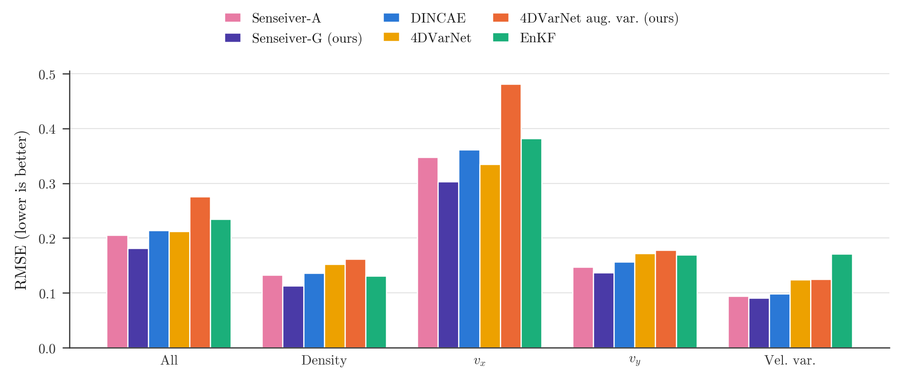
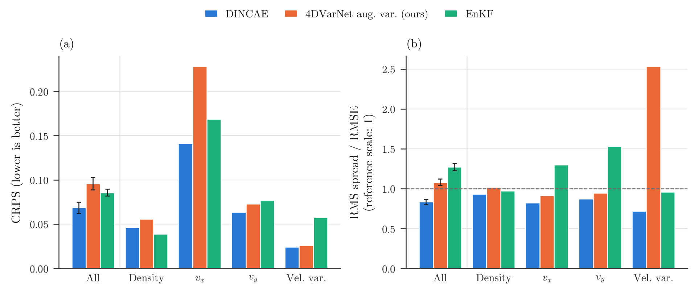
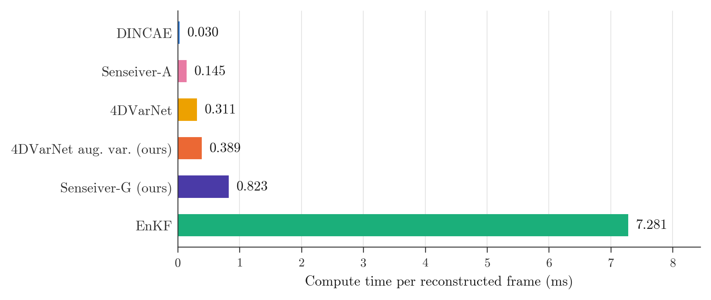

# Partial Observation Comparison — evaluation

Three robots move through a shopping-centre corridor (the ATC pedestrian
dataset, Osaka) and each senses only the cells near itself. Six methods
reconstruct the **full** crowd state — density, velocity $(v_x, v_y)$ and
velocity variance on a 36 × 12 grid, one frame per second — from those partial
observations; three of them also predict their own uncertainty.

This README covers **how the final comparison is evaluated, how the data is
split, and the results**. Background on the methods, training, and the
experiment history is in [PROJECT_OVERVIEW.md](PROJECT_OVERVIEW.md); the
command reference is in [supervisor_evaluation/README.md](supervisor_evaluation/README.md).

The final comparison uses **all 92 days** of the ATC dataset (Wednesdays and
Sundays) and is selected with `DATA_VARIANT=all92` and
`EVAL_VARIANT=six_allwalk_all92`. An earlier, Sunday-only configuration (46 days)
was used during development, where the designs and configuration constants were
chosen; its code paths are still in the repository (`DATA_VARIANT` unset,
`EVAL_VARIANT=six_allwalk`), but its results are not part of it.

## Quick start

On Aalto Triton, from the repository root (each job script sets
`DATA_VARIANT=all92 EVAL_VARIANT=six_allwalk_all92` itself):

```bash
E=supervisor_evaluation/sbatch
sbatch $E/all92_smoke.sbatch            # package + verify the models, ~3 min end-to-end check (not results)
for m in senseiver_a senseiver_g dincae varnet_mse varnet_aughead; do
    sbatch --job-name=all92_$m $E/all92_full_method.sbatch $m          # one method, all 15 test days
done
for k in 0 1 2; do
    sbatch --job-name=all92_enkf$k $E/all92_full_method.sbatch enkf $k/3   # EnKF, a third of the days each
done
sbatch $E/all92_summary.sbatch          # after the above: uncertainty, image boards, error breakdown, tables
sbatch $E/all92_bench.sbatch            # inference time of all six methods on one GPU
```

Results go to `supervisor_evaluation/outputs/full_6m_all92/`.

- **Environment:** `source sbatch/_env.sh` loads Triton's
  `scicomp-pytorch-env/2026.1` (Python 3.12) and sets `PYTHONPATH`; elsewhere,
  `pip install -r requirements.txt`. A GPU is required.
- **Weights:** the eight files listed in
  `supervisor_evaluation/models/manifest_six_allwalk_all92.json` are the frozen
  final models and are part of the repository: the five networks
  (`senseiver_A_pd_all92_epoch097.pt`, `senseiver_G_k16_pd_all92_epoch057.pt`,
  `dincae_varnone_all92_epoch006.pt`, `varnet_kt3_window_all92_epoch080.pt`,
  `varnet_augwink3_all92_epoch104.pt`), the EnKF's forecast model
  (`pedpred3_5to5_all92_epoch_23.pt`) and noise bank
  (`enkf_residual_q_bank_all92.npz`), and DINCAE's normalisation statistics
  (`dincae_state_stats_none_all92.npz`). `evaluate.py prepare` copies them from
  the training runs as named by the validation selections
  (`outputs/reselect_all_walkable_all92_gapmask/`,
  `outputs/dev/varnet_*_all92_gapmask_20261015/`,
  `methods/enkf/runs/pedpred3_lead1_selection_all92_gapmask.json`) and records
  their SHA-256; every run checks them first and refuses to start on a mismatch.
  The other files in `supervisor_evaluation/models/` belong to earlier
  configurations and are not used by these results.
- **Data:** not in the repository; see [Data layout](#data-layout). The job
  scripts use `/scratch/work/zhangx29/data_all92`.

## Dataset split

The ATC dataset records the corridor on Wednesdays and Sundays for about a
year, 92 days in total, and all of them are used. The split is **chronological,
never shuffled** — training is the earliest stretch, validation the middle,
test the latest — so no part of a day is seen from both sides of a boundary.
Every split holds both weekdays.

| Split | Days (Wed + Sun) | Frames | Date range | Used for |
|---|---|---|---|---|
| train | 63 (31 + 32) | 2,525,609 | 2012-10-24 → 2013-06-09 | fitting weights and all training-derived statistics |
| valid | 14 (7 + 7) | 535,739 | 2013-06-12 → 2013-07-28 | choosing every model's checkpoint |
| test | 15 (8 + 7) | 587,227 | 2013-08-07 → 2013-09-29 | every reported number |

The designs and configuration constants (Senseiver-G's latent array and window,
the 4DVarNet prior, the EnKF's process noise) were chosen earlier on the
Sundays alone, with the same split boundaries, and kept fixed.

**Recording gaps.** When the tracker's recording pauses, the one-second
windowing does not skip the missing seconds: after the pause it emits one frame
per sampling timestamp until it has caught up, so those frames hold a single
snapshot under a lagging time label. They are kept in the data and in training
but not scored. `supervisor_evaluation/checks/frame_reliability.py` flags every
frame whose timestamps lie outside its labelled second (0.63% of all frames, on
27 of the 92 days) and writes the flags to `<data-root>/frame_reliability/`;
`crowdcore/frame_reliability.py` then excludes every aligned 200-frame block
with a flagged frame, and the block after it, for every method, in checkpoint
selection and in testing (2.9% of the validation and 1.5% of the test frames).
This is on by default under `DATA_VARIANT=all92` (`GAP_MASK=0/1` overrides) and
off otherwise.

**Where the split is defined.** The code reads three list files from the data
root, `atc_all_{train,valid,test}.lst` (one `ATC/{Wednesdays,Sundays}/atc-YYYYMMDD.h5`
per line; `crowdcore/observation_model.split_files`). Copies of the exact lists
are in [`supervisor_evaluation/data_split/`](supervisor_evaluation/data_split/),
next to the Sunday-only lists of the development configuration. The `verify`
step that starts every run fails unless the test list and the test dates of the
evaluation variant name exactly the same days.

## Data layout

```
<data-root>/                                   # /scratch/work/zhangx29/data_all92
  atc_all_train.lst  atc_all_valid.lst  atc_all_test.lst
  ATC/Sundays/atc-YYYYMMDD.h5  ATC/Wednesdays/atc-YYYYMMDD.h5   # trajectories (from the raw CSVs)
  grid_cache/atc-YYYYMMDD_corridor_1.0s.h5     # one gridded file per day
  grid_cache/visited_union_train_tau0.5_corridor.npy   # training-day walkable evidence
  frame_reliability/atc-YYYYMMDD.npy           # recording-gap flags, one bool per frame
```

Each gridded day file holds `grid` — float32 `(N, 4, 36, 12)`, channels
`[density, vx, vy, vel_var]`, 1 m cells, one frame per second — and `time`
`(N,)`. They are produced from the raw ATC CSV files by
`crowdcore/data/csv_to_h5.py` and `crowdcore/data/h5_to_grid.py`
(`sbatch/regrid_wednesdays.sbatch` for the Wednesdays); the pipeline and its
validation are documented in
[crowdcore/data/DOC_data_pipeline.md](crowdcore/data/DOC_data_pipeline.md).
The walkable mask is the same 290 cells as with the Sundays alone.

## Observation protocol

Set in `crowdcore/config.yaml` (`observation:`), identical for every method:
three robots follow A* routes between random walkable goals, one cell per
second; a walkable cell is observed at a frame if it is within 7 cells of a
robot and in line of sight (obstacles from the real ATC map block sight).
On average about 56% of walkable cells are observed at a frame; the other 44%
are the blind cells. Observations carry per-channel Gaussian noise. Robot routes
are seeded by the day's date, so every day has its own routes and every script
sees the same observations for a day. All learned models were trained with
these per-day routes.

## Results, and how to read them

All numbers are over the 15 test days, with the recording-gap blocks excluded.
Accuracy and uncertainty are reported on **all walkable cells** (observed and
blind) and on the **blind cells** alone — the walkable cells that no robot sees
at that frame, where the state must be inferred. Obstacle cells are never
scored. The four quantities being reconstructed are:

| Channel | Meaning | Unit |
|---|---|---|
| Density | how many people are in the cell | ≈ people per m² |
| $v_x$, $v_y$ | mean walking velocity in the cell, along and across the corridor | m/s |
| Vel. var. | how much the velocities in the cell disagree (people walking in different directions) | (m/s)² |

### 1. Reconstruction accuracy — how close is the reconstructed field to the truth?

**RMSE** (root-mean-square error): the typical size of the difference between
the reconstructed value and the true value, in the channel's own unit. **Lower
is better.** "All" pools the four channels into one number.

| Method | All walkable: All | Density | $v_x$ | $v_y$ | Vel. var. | Blind: All | Density | $v_x$ | $v_y$ | Vel. var. |
|---|---|---|---|---|---|---|---|---|---|---|
| Senseiver-A | 0.144 | 0.093 | 0.242 | 0.102 | 0.068 | 0.206 | 0.133 | 0.347 | 0.147 | 0.094 |
| **Senseiver-G (ours)** | **0.125** | **0.077** | **0.209** | **0.094** | **0.064** | **0.182** | **0.113** | **0.303** | **0.137** | **0.091** |
| DINCAE | 0.176 | 0.117 | 0.296 | 0.125 | 0.083 | 0.214 | 0.136 | 0.362 | 0.157 | 0.098 |
| 4DVarNet | 0.181 | 0.108 | 0.307 | 0.136 | 0.085 | 0.212 | 0.152 | 0.335 | 0.172 | 0.124 |
| 4DVarNet aug. var. (ours) | 0.226 | 0.114 | 0.407 | 0.138 | 0.085 | 0.276 | 0.162 | 0.481 | 0.178 | 0.125 |
| EnKF | 0.199 | 0.112 | 0.334 | 0.139 | 0.126 | 0.235 | 0.131 | 0.382 | 0.170 | 0.171 |



*How to read the figure:* each group of bars is one channel (the left group is
all channels together); each colour is one method, the same colour in every
figure. A shorter bar is a smaller error.

*What it shows:* Senseiver-G has the smallest error overall and on every
channel, on both sets of cells. Giving 4DVarNet an uncertainty output (aug. var.)
costs accuracy, mostly on $v_x$. On the blind cells the EnKF is the second most
accurate method on density, but it has by far the largest error on velocity
variance.

### 2. Uncertainty — does the method know how wrong it is?

Three methods provide a predictive distribution for every cell. DINCAE and the
augmented 4DVarNet predict a value and a standard deviation σ̂; the EnKF provides
100 analysis members, whose spread supplies σ̂. Two numbers judge their
probabilistic predictions:

**CRPS — the overall score of the predictive distribution. Lower is better.** The
CRPS (continuous ranked probability score) scores each cell's predictive
distribution in the channel's own unit: it is smallest when the prediction is
accurate and its uncertainty matches the error. Inflating or shrinking the
uncertainty alone cannot reliably improve this proper score. Because CRPS also
scores the predicted value, it rates the probabilistic prediction as a whole.

**Spread / RMSE — is σ̂ the right size on average? 1 is ideal.** Spread is the
root-mean-square of σ̂ over all scored cells; RMSE is the actual error. Below 1:
the method is overconfident (σ̂ too small). Above 1: it is too cautious (σ̂ too
large). This only checks the overall size, not whether σ̂ is large in the right
cells — that is what CRPS adds.

**The range in brackets (95% interval)** shows how much a number depends on
which days happened to be the test days: the result is recomputed 10,000 times,
each time on a random re-draw of the 15 test days.

| Method | Blind: CRPS | 95% range | Spread / RMSE | 95% range | All walkable: CRPS | Spread / RMSE |
|---|---|---|---|---|---|---|
| **DINCAE** | **0.069** | 0.062–0.075 | 0.83 | 0.80–0.87 | **0.055** | 0.57* |
| 4DVarNet aug. var. (ours) | 0.096 | 0.089–0.103 | 1.08 | 1.04–1.12 | 0.084 | 1.17 |
| EnKF | 0.086 | 0.082–0.090 | 1.27 | 1.23–1.32 | 0.072 | 1.26 |

\* On all walkable cells, DINCAE's spread/RMSE (interval 0.39–0.81) is distorted
by a few unclipped velocity-variance predictions on observed cells that lie far
outside the physical range — 6,781 values, 0.007% of the scored ones, most of
them in cells whose true velocity variance itself exceeds 2; its CRPS is hardly
affected (`outputs/full_6m_all92/dincae_outliers_v2.json`,
`supervisor_evaluation/checks/diag_dincae_outliers.py`).



*What it shows:* DINCAE has the lowest CRPS on both sets of cells and on each of
the 15 test days; the EnKF leads on density. On the blind cells DINCAE's spread
is smaller than its error (0.83) and the EnKF's larger (1.27). The augmented
4DVarNet's pooled ratio is closest to one (1.08), but its velocity-variance
channel is at 2.54 while the other channels are near or slightly below 1.
Per-channel numbers: `uncertainty_by_channel*.csv`.

#### The math behind the two numbers

For each scored cell $i$ (all cells of all frames, $N$ in total), a method gives a
value $\mu_i$ and an uncertainty $\hat\sigma_i$; the truth is $x_i$ and the error
is $e_i = x_i - \mu_i$.

**Spread / RMSE** compares two averages that are computed *separately*:

$$
\text{Spread / RMSE} \;=\; \frac{\sqrt{\dfrac{1}{N}\sum_{i}\hat\sigma_i^2}}{\sqrt{\dfrac{1}{N}\sum_{i} e_i^2}}
$$

If σ̂ is exactly right, the expected squared error in each cell is $\hat\sigma_i^2$,
so the two averages agree and the ratio is 1. Which $\hat\sigma$ belongs to which
error is lost when each is averaged, so this number can only say whether σ̂ has the
right overall size.

**CRPS** scores each cell's predictive distribution against its truth. For a
prediction that is a normal distribution $\mathcal{N}(\mu_i, \hat\sigma_i^2)$ it has
a closed form (Gneiting & Raftery, 2007):

$$
\text{CRPS}_i \;=\; \hat\sigma_i\left[\, z_i\,\big(2\Phi(z_i)-1\big) + 2\,\varphi(z_i) - \frac{1}{\sqrt{\pi}} \right],
\qquad z_i = \frac{e_i}{\hat\sigma_i},
\qquad \text{CRPS} = \frac{1}{N}\sum_i \text{CRPS}_i
$$

where $\Phi$ and $\varphi$ are the standard normal distribution and density
functions. It is small only when the error is small *and* $\hat\sigma_i$ matches
it: a large error with a tiny $\hat\sigma_i$ is punished hard (overconfident), and
a large $\hat\sigma_i$ where the error is small is punished too (too cautious).
When $\hat\sigma_i \to 0$ it becomes the absolute error $|e_i|$. It is a *proper*
score: a method gets its best expected CRPS only by reporting its honest
uncertainty.

**A two-cell example.** Two methods predict the same values, so they have the
same errors (0 in cell 1, 2 in cell 2), and the same set of σ̂ values — only in
different cells:

| | cell 1: error 0 | cell 2: error 2 | Spread / RMSE | CRPS |
|---|---|---|---|---|
| Method A: σ̂ | 0.01 | 2 | 1.00 | **0.60** |
| Method B: σ̂ | 2 | 0.01 | 1.00 | **1.23** |

A says "I am unsure" exactly where it is wrong; B says "I am sure" exactly where
it is wrong. Spread/RMSE cannot tell them apart — both are a perfect 1.00. CRPS
rates A twice as good as B. This is why CRPS is the main uncertainty measure and
spread/RMSE only a check on overall size.

DINCAE and the augmented 4DVarNet are scored with the Gaussian formula above,
in physical units. The EnKF is scored with the **empirical CRPS of its 100 analysis members**
$x_1,\dots,x_N$ ($N = 100$), so the Gaussian formula above is not applied to its
ensemble:

$$
\text{CRPS}_i \;=\; \frac{1}{N}\sum_{k} |x_k - y| \;-\; \frac{1}{2N^{2}}\sum_{k}\sum_{l} |x_k - x_l|
$$

with $y$ the truth in that cell. This form makes no assumption about the shape of
the ensemble distribution, so it also charges the filter for the skewness and the
clipping at zero that a mean-and-spread summary would hide.

### 3. Inference time — how fast is each method?

The median GPU time to reconstruct one frame, measured for every method in one
job on the same GPU (a Tesla V100-SXM2-16GB) and the same 600 frames of the first
test day, with the inputs prepared beforehand.

| DINCAE | Senseiver-A | 4DVarNet | 4DVarNet aug. var. | Senseiver-G | EnKF |
|---|---|---|---|---|---|
| 0.030 ms | 0.145 ms | 0.31 ms | 0.39 ms | 0.82 ms | 7.3 ms |



Every method is far faster than the data itself, which arrives at one frame per
second. The two 4DVarNet models reconstruct 200-frame windows; their time is per
frame. DINCAE and both 4DVarNet models also need observations after the frame
they reconstruct.

### Files

The numbers above are in `supervisor_evaluation/outputs/full_6m_all92/`:
`accuracy.csv` and `accuracy_all_walkable.csv`, `uncertainty.csv` and
`uncertainty_all_walkable.csv` (with their per-channel versions),
`inference_time_controlled.csv`, the error breakdown in `breakdown/`, image
boards in `images/`, and figure captions in `figures/captions.md`. The exact
definitions and code are in `supervisor_evaluation/evaluate.py`,
`compare/score_uncertainty.py` and `supervisor_evaluation/breakdown.py`.
